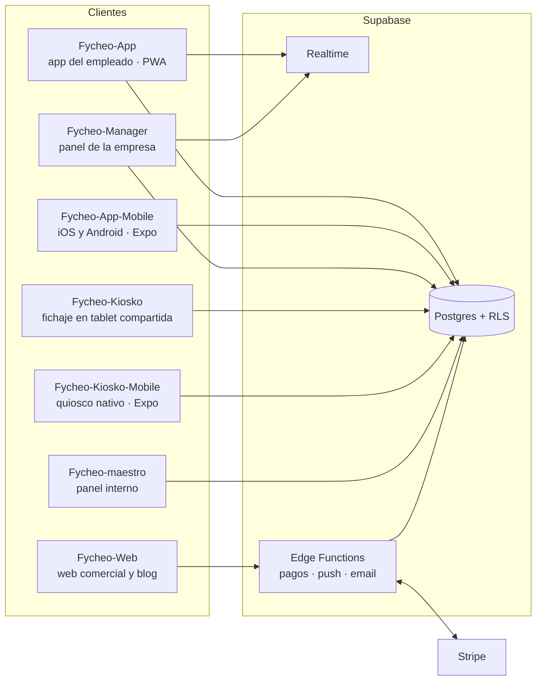

# Fycheo — Demo

**SaaS de control horario y gestión de equipos para empresas españolas.** Fichaje con geolocalización, turnos, ausencias, documentos, chat interno, avisos e informes, con el registro horario obligatorio cubierto (conservación durante 4 años).

🌐 **[fycheo.es](https://fycheo.es)** · 🧪 **[demo.fycheo.es](https://demo.fycheo.es)**

Este repositorio es la **versión de demostración**: una empresa ficticia, «Distribuciones Martínez S.A.», con 24 empleados y 12 meses de historial. Corre sobre la **misma base de datos de producción** de Fycheo, como una empresa más marcada con `is_demo`, aislada del resto por RLS, con reinicio automático cada noche y sin acceso a pagos ni a envío de correos. El código de producción es privado y lo enseño en entrevista si hace falta.

<!-- Añadir aquí capturas: panel de gestión, app del empleado y modo quiosco -->
<!--  -->

---

## El producto: 7 aplicaciones, una sola base de datos

| Aplicación | Para quién | Qué hace |
| --- | --- | --- |
| App del empleado (web y móvil) | Trabajadores | Fichar con geolocalización, ver turnos, pedir ausencias, chat, documentos e historial |
| Panel de gestión | Responsables y RR. HH. | Equipos, planificación de turnos, aprobación de solicitudes, informes y facturación |
| Quiosco (web y móvil) | Centros con tablet compartida | Fichaje rápido sin que cada empleado use su móvil |
| Web comercial | Empresas interesadas | Planes, alta y blog |
| Panel interno | Equipo de Fycheo | Gestión de las empresas cliente |

## Partes técnicas destacadas

- **Multiempresa con RLS:** cada empresa solo ve sus datos, y cada rol (empleado, responsable, administrador) solo lo que le corresponde. Las reglas viven en Postgres, no en la interfaz.
- **Wallet de empresa con Stripe:** saldo con recargas automáticas mensuales, Payment Intents y webhooks validados en el servidor (Edge Functions), con restricciones en la base de datos para que el saldo no quede en un estado imposible.
- **Tiempo real:** fichajes y avisos que llegan al panel sin recargar, con Supabase Realtime.
- **Notificaciones push** a las apps móviles desde Edge Functions.
- **Auditoría de seguridad** de la app móvil, con las correcciones aplicadas: validación del origen en la comunicación WebView ↔ app, credenciales fuera del código y revisión del almacenamiento de la sesión.

## Esta demo

- React 19 + TypeScript + Vite + Tailwind CSS 4.
- **Misma base de datos que producción.** La empresa demo es una fila más de `companies`, con `is_demo = true`. Las políticas RLS hacen que su administrador solo vea sus propios datos, exactamente igual que cualquier empresa cliente: no hay un esquema ni un proyecto aparte que mantener sincronizado.
- **Reinicio nocturno.** Cada noche la empresa vuelve a su estado inicial, así que quien la visita puede tocar lo que quiera: crear turnos, aprobar ausencias, importar empleados por CSV…
- **Sin efectos secundarios.** Las Edge Functions de pagos (Stripe), correo e invitaciones responden 403 para la empresa demo. El alta de empleados pasa por una función de base de datos propia (`demo_add_employee`) que crea el usuario, su perfil y su vínculo con la empresa sin enviar nada.
- **Acceso por invitación.** La puerta de entrada comprueba el email contra la lista de invitados mediante una RPC (`demo_check_access`) que solo responde sí o no; la lista en sí no es legible desde el navegador.
- **Historial siempre reciente.** Las fechas de los datos se desplazan al día actual en el cliente (`src/lib/date-adjuster.ts`) respetando el día de la semana, para que los fines de semana sigan cayendo en sábado y domingo.
- `seed/`: scripts SQL con los que se generó originalmente la empresa ficticia (equipos, empleados, turnos, fichajes, ausencias y registros de 12 meses). Se conservan como referencia; en producción la empresa la crea y la reinicia el equipo de Fycheo.
- `SETUP.md`: cómo ejecutar la demo en local.

---

Diseñado y desarrollado por **Ronald Herrera** · [ronaldherrera.es](https://ronaldherrera.es) · [LinkedIn](https://linkedin.com/in/ronald-sc-herrera)
