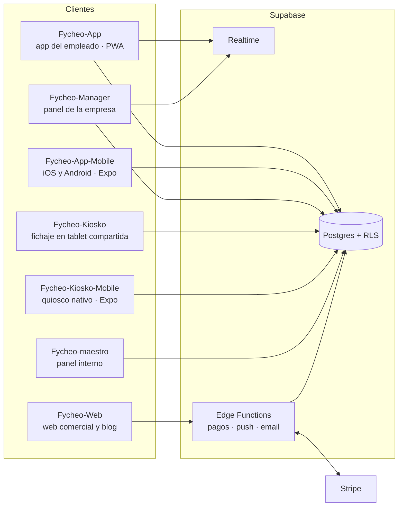

# Fycheo — Demo

**SaaS de control horario y gestión de equipos para empresas españolas.** Fichaje con geolocalización, turnos, ausencias, documentos, chat interno, avisos e informes, con el registro horario obligatorio cubierto (conservación durante 4 años).

🌐 **[fycheo.es](https://fycheo.es)**

Este repositorio es la **versión de demostración**: una empresa ficticia, «Distribuciones Martínez S.A.», con 12 meses de historial, sobre un proyecto de Supabase separado del de producción y con el mismo esquema. El código de producción es privado y lo enseño en entrevista si hace falta.

<!-- Añadir aquí capturas: panel de gestión, app del empleado y modo quiosco -->
<!--  -->

---

## El producto: 7 aplicaciones, una sola base de datos

| Aplicación | Para quién | Qué hace |
| --- | --- | --- |
| App del empleado (web y móvil) | Trabajadores | Fichar con geolocalización, ver turnos, pedir ausencias, chat, documentos e historial |
| Panel de gestión | Responsables y RR. HH. | Equipos, planificación de turnos, aprobación de solicitudes, informes y facturación |
| Quiosco (web y móvil) | Centros con tablet compartida | Fichaje rápido sin que cada empleado use su móvil |
| Web comercial | Empresas interesadas | Planes, alta y blog |
| Panel interno | Equipo de Fycheo | Gestión de las empresas cliente |

## Partes técnicas destacadas

- **Multiempresa con RLS:** cada empresa solo ve sus datos, y cada rol (empleado, responsable, administrador) solo lo que le corresponde. Las reglas viven en Postgres, no en la interfaz.
- **Wallet de empresa con Stripe:** saldo con recargas automáticas mensuales, Payment Intents y webhooks validados en el servidor (Edge Functions), con restricciones en la base de datos para que el saldo no quede en un estado imposible.
- **Tiempo real:** fichajes y avisos que llegan al panel sin recargar, con Supabase Realtime.
- **Notificaciones push** a las apps móviles desde Edge Functions.
- **Auditoría de seguridad** de la app móvil, con las correcciones aplicadas: validación del origen en la comunicación WebView ↔ app, credenciales fuera del código y revisión del almacenamiento de la sesión.

## Esta demo

- React 19 + TypeScript + Vite + Tailwind CSS 4.
- `seed/`: scripts SQL que crean la empresa ficticia, sus equipos, empleados, turnos, fichajes, ausencias y registros de actividad de 12 meses.
- `SETUP.md`: cómo montar tu propia copia sobre un proyecto de Supabase vacío.

---

Diseñado y desarrollado por **Ronald Herrera** · [ronaldherrera.es](https://ronaldherrera.es) · [LinkedIn](https://linkedin.com/in/ronald-herrera)
